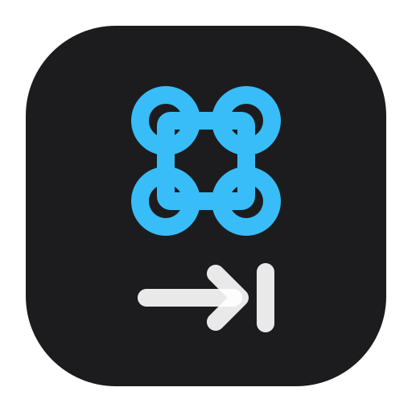

<p align="center">
  
</p>

<h1 align="center">Omarchy Cmdtab</h1>

<p align="center">
  <em>macOS Cmd+Tab for Hyprland, in the Omarchy shell.</em>
</p>

<p align="center">
  <a href="https://github.com/illegalstudio/omarchy-cmdtab/stargazers"></a>
  <a href="LICENSE"></a>
  <a href="https://omarchy.org"></a>
  <a href="https://x.com/nahime0"></a>
</p>

<p align="center">
  <strong>Most-recently-used order &middot; One tap goes back &middot; Vim navigation &middot; Every workspace at once</strong>
</p>

<p align="center">
  An Omarchy shell overlay that lists every open window in the order you last used them, the way Cmd+Tab does on macOS. Hold SUPER and tap TAB to select the window you just came from, keep tapping TAB to go further back, then release SUPER to bring the selection to the front. Use h and l to move through the icons while holding SUPER.
</p>

<p align="center">
  <a href="https://opensource.nahi.me"><strong>Official Website</strong></a>
</p>

---

## Install

### 1. Add the plugin

```bash
omarchy plugin add https://github.com/illegalstudio/omarchy-cmdtab.git --enable
```

### 2. Bind it

Load the bundled Hyprland bindings from `~/.config/hypr/bindings.lua`:

```lua
dofile((os.getenv("XDG_CONFIG_HOME") or os.getenv("HOME") .. "/.config")
  .. "/omarchy/plugins/illegalstudio.omarchy-cmdtab/hyprland.lua")("SUPER")
```

This replaces the default SUPER+TAB and SUPER+SHIFT+TAB workspace bindings. The bundled configuration creates a dedicated `omarchy-cmdtab` submap and enters it before launching the overlay. While switching, h, l, Escape, Tab and modifier release belong to Cmdtab; unused keys are consumed. Normal Omarchy shortcuts resume when the switcher closes.

Remove the old Cmdtab binding block if upgrading, including the former global `cancelOrMenu`, `vimNavigate`, and modifier-release bindings. Keep your usual SUPER+H/L and SUPER+ESCAPE bindings: they no longer need to call the plugin and are isolated while Cmdtab is open.

For ALT+TAB, pass `"ALT"` instead of `"SUPER"` to the same function. Modifier-release handling is configured automatically.

## Remove

```bash
omarchy plugin disable illegalstudio.omarchy-cmdtab
omarchy plugin remove illegalstudio.omarchy-cmdtab
```

Then remove the `dofile` call from `~/.config/hypr/bindings.lua` and reload Hyprland to restore its default shortcuts.

## Using the switcher

Windows appear in a compact horizontal strip with large application icons, a rounded translucent background, and a highlight around the selection. Only the selected icon shows its application name beneath it. The strip scrolls when there are more windows than fit on screen.

Windows are ordered most recently used first across every workspace. The first icon is the current window, the second is the one before it. **Hold SUPER, tap TAB, then release SUPER** to switch back. Keep holding SUPER and tap TAB again to continue through the list. SHIFT+TAB moves backwards; h and l move left and right.

Icons and application names come from desktop entries, including Omarchy webapps launched through Brave, Chrome, Chromium, and Edge. The selected window receives focus and is explicitly raised above other windows, including in floating workspaces.

The switcher only supports keyboard selection and cancellation. It has no text search, mouse selection, arrow-key navigation, or Enter shortcut. Unused keys are swallowed while the overlay is open.

## Keyboard controls

| Key | Action |
| --- | --- |
| Release `SUPER` | Focus and raise the selected window. |
| `l`, `Tab` | Next window, further back in time. |
| `h`, `Shift+Tab` | Previous window. |
| `Esc` (also with SUPER held) | Cancel and close the switcher. |

## How the order is decided

Hyprland already ranks every client by how recently it held focus and reports it as `focusHistoryID` in `hyprctl -j clients`, where `0` is the focused window. The overlay sorts on that field, so the order always matches what the compositor itself believes, with no history of its own to drift or to lose across a shell restart.

The highlight starts one step past the focused window. When no window is focused at all, on an empty workspace for instance, row 0 is already the window you last used, so the highlight starts there instead of skipping it.

Hyprland builds that predate `focusHistoryID` still work: the list falls back to grouping by workspace and then by application name.

## Requirements

- Omarchy 4 or newer with the current shell plugin system.
- Hyprland Lua configuration with `hl.define_submap` support.
- A Hyprland that reports `focusHistoryID` in `hyprctl -j clients`; check with
  `hyprctl -j clients | grep -m1 focusHistoryID`. Developed against 0.56. Builds
  without it still list every window, just not in recency order.

## Configuration

The overlay uses the active Omarchy theme for its background, with a rounded macOS-style horizontal layout showing icons and the selected application's name. No configuration is required beyond the keybindings.

## IPC

```bash
omarchy-shell shell call illegalstudio.omarchy-cmdtab cycle 1
omarchy-shell shell call illegalstudio.omarchy-cmdtab cycle -1
omarchy-shell shell call illegalstudio.omarchy-cmdtab release super
omarchy-shell shell call illegalstudio.omarchy-cmdtab confirm ""
omarchy-shell shell call illegalstudio.omarchy-cmdtab dismiss ""
omarchy-shell shell call illegalstudio.omarchy-cmdtab vimNavigate h
omarchy-shell shell call illegalstudio.omarchy-cmdtab vimNavigate l
```

`cycle` opens the switcher or moves the highlight by the given step. An optional `alt` argument, for example `cycle "1 alt"`, selects ALT release instead of SUPER release. `release` confirms only when its modifier matches. `confirm` activates the current selection and answers `closed` when the overlay is not up. A release received during the initial client query waits for the results before activating, so quick taps work too.

`vimNavigate` accepts h or l and only moves the selection while the overlay is open. Closing the overlay restores the default Hyprland submap; Escape and modifier release also reset it directly in the compositor so they still work if shell IPC fails.

## Development install

From a local checkout, expose the repository through the user plugin directory. Do not modify the packaged Omarchy files under `/usr/share/omarchy`.

```bash
ln -s "$PWD" "$HOME/.config/omarchy/plugins/illegalstudio.omarchy-cmdtab"
omarchy plugin enable illegalstudio.omarchy-cmdtab
```

Validate the manifest and run the test suite with:

```bash
make check
```

The tests extract the overlay's pure functions from `Cmdtab.qml` and run them under Node against a recorded `hyprctl clients` payload. Lua tests load the actual `hyprland.lua` and verify scoped bindings, key consumption, and entry/exit ordering. Development checks require Node, Lua, Python, and Omarchy.

`keepLoaded` plugins are instantiated once and kept, so editing the QML is not picked up by the shell's hot reload. Apply changes with `omarchy restart shell`.

## Release

From a clean checkout synchronized with its tracked branch on `origin`, run:

```bash
make release
```

The script reads local and remote semantic version tags, proposes the next patch version, and lets you choose another `MAJOR.MINOR.PATCH` version. For the first release, it proposes the version already in `manifest.json`.

Before changing anything, it shows the manifest update, tag, branch, checks, commit, and publication plan and asks for confirmation. Cancelling leaves the checkout and remote unchanged.

After confirmation it updates the manifest if needed, runs `make check`, creates the release commit and an annotated tag, and pushes the tracked branch and tag atomically. GitHub Actions validates the tag and manifest, runs the tests, and creates the GitHub Release with generated notes. If the push fails, the local commit and tag are preserved for recovery.

## Safety

The overlay runs `hyprctl`: `-j activewindow` and `-j clients` to read, and `eval` to manage the keyboard submap and focus the window you picked. The QML overlay passes fixed argument arrays. The bundled Lua bindings call shell IPC with fixed method names and quoted arguments. Window addresses are validated as hexadecimal before interpolation into Lua. Application metadata and icons are read through Quickshell's desktop-entry index and icon lookup. The plugin writes no files.

## License

[MIT](LICENSE)
